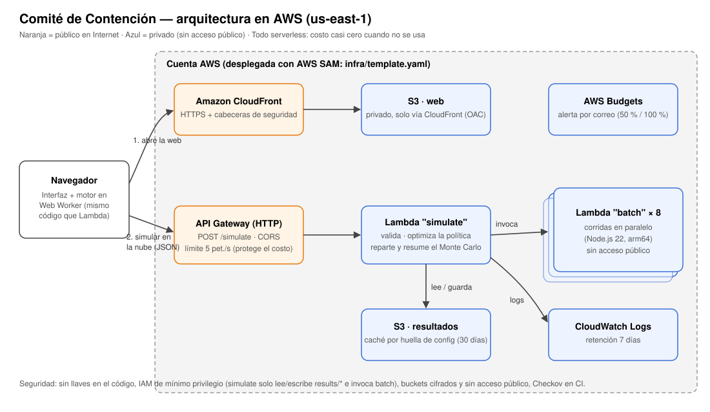

# Comité de Contención 🧟 — La Plaga Zombie en Manta

**SpookyThon 2026 · Track B.** Una herramienta que simula cómo se propaga una plaga en Manta y encuentra **qué hacer, dónde y cuándo** (vacunas, cuarentenas y cierres) con recursos limitados. Muestra con números cuánta gente se salva frente a **no hacer nada** y frente a **actuar al azar con los mismos recursos**.

- **App desplegada:** https://d3op4ankgl1i6w.cloudfront.net (región **us-east-1**, N. Virginia: la más barata y con todos los servicios que usamos)
- **Arquitectura:** [docs/arquitectura.svg](docs/arquitectura.svg) (fuente: [docs/arquitectura.mmd](docs/arquitectura.mmd))
- **Costos:** [docs/costos.md](docs/costos.md)
- **Resultados reproducibles de todos los escenarios:** [docs/resultados.md](docs/resultados.md)
- **AWS Budget con alerta:** [docs/budget.png](docs/budget.png) _(captura de la consola)_



---

## Resultados clave (200 simulaciones por escenario, semilla 2026)

| Escenario | Mordidos sin hacer nada | Al azar (mismos recursos) | Con la estrategia | Gana al azar en brotes que despegan |
|---|---|---|---|---|
| Base | 79.178 | 71.222 | **767** | 94 % |
| ×2 contagio | 206.172 | 198.179 | **109.259** | 89 % |
| Empieza en un colegio | 110.549 | 98.706 | **2.973** | 100 % |
| Vacuna cubre a medias | 79.178 | 71.057 | **293** | 94 % |
| Todo junto (×2 contagio, ½ vacunas, vacuna 30 %) | 206.172 | 203.223 | **165.641** | 67 % (pierde en 31 %) |

Tabla completa con rangos, política elegida y huella de cada escenario: [docs/resultados.md](docs/resultados.md).

## Qué hace

1. **Simula la propagación día a día** en una red de contactos sintética de Manta: hogares, colegios, trabajos, buses, mercados y barrios de las 5 parroquias urbanas.
2. **Aplica intervenciones con recursos limitados**: vacunas que llegan por día, cuarentena del hogar de cada caso reportado y cierre de mercados o colegios por parroquia, todo pagado con un presupuesto total.
3. **Compara la estrategia contra dos líneas base**: no intervenir, e intervenir **al azar con exactamente los mismos recursos** (mismas dosis por día, mismas cuarentenas, mismos bloques de cierre).
4. **Repite la simulación muchas veces** (Monte Carlo) y reporta **promedios y rangos** (percentiles 5 % y 95 %).
5. Tiene una **interfaz** para cambiar contagio, vacunas, presupuesto y punto de inicio, y **6 botones de "Brote Sorpresa"**.
6. Es **reproducible**: misma configuración + misma semilla = mismo resultado, en el navegador y en AWS (está probado en los tests).
7. Está **desplegada en AWS** (S3 + CloudFront + API Gateway + Lambda).
8. Genera un **informe para el alcalde** en lenguaje simple.
9. **La ciudad en vivo:** mapa **real** de Manta (imagen satelital de Esri y límites oficiales de las 5 parroquias urbanas de OpenStreetMap) con 10.000 personas ubicadas donde de verdad hay edificios y calles, en tres paneles (no hacer nada / al azar / Comité) para el mismo brote, con cuarentenas, cierres y fumigaciones día a día, y pantalla completa para proyectar. Se anima la corrida **mediana** de los brotes que despegan, no la más favorable.
10. **Calibración con datos reales:** el mismo motor, ajustado a los casos semanales de dengue en Manabí 2024 del Ministerio de Salud Pública (ver [docs/calibracion.md](docs/calibracion.md)). El botón 🦟 aplica esa plaga calibrada a Manta, con brigadas de fumigación.
11. **"¿Qué cambió?"** tras cada Brote Sorpresa: antes y después, y la explicación en palabras de cómo cambió la recomendación.

## Cómo usarla

1. Abre la app. Pulsa **Simular** (100 simulaciones, unos 10 segundos en el navegador; con la casilla "Correr en AWS", en paralelo en Lambda).
2. Lee la frase de arriba y los cuatro indicadores: cuántos se salvan frente a no hacer nada, frente al azar, en cuántos brotes gana y cuánto cuesta.
3. Cambia las condiciones con los botones de **Brote Sorpresa** (×2 contagio, ½ vacunas, empieza en el mercado, vacuna que cubre a medias, respuesta tardía, ½ presupuesto). La estrategia **se vuelve a optimizar sola**.
4. Copia el **Informe para el alcalde**.

---

## El modelo

### La plaga
"Mordida zombi" inspirada en una **influenza fuerte**, contagiosa de persona a persona como describe el reto (casa, bus, colegio, mercado).

| Estado | Significado | ¿Lo ve el comité? |
|---|---|---|
| 🟢 Sano (S) | susceptible | — |
| 🟡 Mordido (E) | contagiado, aún no contagia | **No** (parece sano) |
| 🔴 Zombi (I) | contagia | Solo si se **reporta** (probabilidad diaria) |
| 🔵 Exorcizado (R) | recuperado o vacunado con éxito | Sí, si fue reportado o vacunado |

Modelo **SEIR estocástico basado en agentes** sobre un **grafo de contactos por capas**. Cada día, una persona sana o mordida recibe una "presión de contagio" de los zombis de cada lugar al que asiste:

```
presión(i) = zombis en su hogar
           + Σ capas  asistencia × contactos por día × zombis que asisten al lugar / (personas del lugar − 1)
P(mordida hoy) = 1 − e^(−q × presión)
```

`q` (probabilidad de contagio por contacto) se **calcula** para lograr el R0 elegido: `R0 ≈ q × días contagiosos × contactos efectivos promedio`. Así, el control "Contagio" de la interfaz es directamente el R0.

### Por qué es riguroso (y explicable en 30 segundos)
- **Números aleatorios comunes:** en cada corrida, las tres estrategias enfrentan **el mismo brote** (mismo paciente cero, mismas respuestas a la vacuna, mismo cumplimiento de cuarentena). La diferencia se debe a la estrategia, no a la suerte.
- **Muchas simulaciones**, con promedio y rango del 5 % al 95 %.
- **Veredicto con prueba estadística:** la interfaz dice ✅ o ❌ si la estrategia supera a cada línea base, con una **prueba de signos** sobre los brotes que despegan (si fuera igual de buena, ganar o perder cada brote sería como lanzar una moneda). Así, cuando el jurado elige su semilla, se ve al instante si ganar fue suerte.
- **Victorias medidas donde importa:** con un solo caso inicial, muchos brotes se apagan solos antes de que el comité actúe (como en la realidad). En esos casos todas las estrategias empatan; por eso el "% de victorias" se mide sobre los **brotes que despegan** y los empates se informan aparte.
- **Información imperfecta:** el comité solo ve los casos **reportados**; los mordidos son invisibles. La estrategia **nunca vacuna a un caso reportado** (test automático). Las dosis que caen en mordidos ocultos se cuentan y se muestran.
- **Determinismo total:** generador `xoshiro128**` sembrado con `splitmix32`, y una `e^(−x)` propia hecha solo con sumas y multiplicaciones (la `Math.exp` de JavaScript puede variar en el último bit entre navegadores).

---

## La estrategia del Comité

**Contención adaptativa, optimizada por simulación.** Cada día, con los casos reportados:

1. **Cuarentena:** aísla 7 días el hogar de cada caso reportado (la mayor parte del contagio ocurre en casa y los convivientes pueden estar mordidos sin que se note).
2. **Vacunas:** reparte las dosis del día por **puntaje = riesgo de ser mordido hoy × a cuántas personas podría morder después**. Solo vacuna a quien a la vista está sano.
3. **Cierres:** cierra el mercado o los colegios **solo de la parroquia** donde los casos reportados superan un umbral (más barato que cerrar toda la ciudad).

4. **Fumigación (solo si la plaga la transmite un mosquito, como el dengue):** envía brigadas a la parroquia donde los casos reportados superan un umbral; mientras dura, el contagio en esa parroquia baja a la mitad (**SUPUESTO**), también dentro de las casas.
5. **Reserva de presupuesto:** puede guardar parte del dinero (0 % o 50 %) para cuarentenas y cierres en vez de gastarlo todo en vacunas los primeros días. Lo descubrimos probando: gastar todo en vacunas al inicio deja sin dinero para aislar los casos que aparecen después, y el brote se escapa.

**Optimizador:** antes de recomendar, prueba **21 políticas candidatas** (3 formas de priorizar vacunas × con o sin cierres × con o sin cuarentenas × reserva del 0 % o 50 %) en corridas de **entrenamiento con semillas distintas** a las de evaluación, y elige la que deja menos mordidos; si empatan, la más barata. Después la evalúa en corridas nuevas. Cuando el jurado cambia las condiciones (Brote Sorpresa), **la estrategia se vuelve a optimizar sola** y puede cambiar de política: por ejemplo, si todo empeora a la vez, prioriza a los más conectados de la ciudad en vez del entorno de los casos.

| Prioridad de vacunas | Qué hace |
|---|---|
| Anillo | entorno de los casos reportados, empezando por los más conectados |
| Mixta | mezcla el entorno de los casos con los más conectados de la ciudad |
| Más conectados | protege primero a quien tiene más contactos diarios, sin esperar a los casos |

---

## Supuestos y de dónde salen los números

Todos están en [src/engine/config.js](src/engine/config.js) y se pueden cambiar desde la interfaz o la API.

| Parámetro | Valor | Fuente / justificación |
|---|---|---|
| Población urbana de Manta | 258.697 | INEC, Censo 2022 (cantón: 271.145) — [Wikidata Q1990138](https://www.wikidata.org/wiki/Q1990138), [Manta (Ecuador)](https://es.wikipedia.org/wiki/Manta_(Ecuador)) |
| Parroquias urbanas | Manta, Tarqui, Los Esteros, Eloy Alfaro, San Mateo | [Cantón Manta](https://es.wikipedia.org/wiki/Cant%C3%B3n_Manta) |
| Personas por hogar | 3,3 | INEC, Censo 2022, Manabí — [resultados de Manabí](https://www.censoecuador.gob.ec/wp-content/uploads/2024/01/Info_Manabi.pdf) |
| Hogares unipersonales | 14,5 % | INEC, Censo 2022, Manabí (mismo documento) |
| R0 | 1,8 | Mediana de la pandemia de influenza de 1918 en [Biggerstaff et al. 2014, BMC Infect Dis 14:480](https://www.biomedcentral.com/1471-2334/14/480) (estacional: 1,28) |
| Días como mordido (incubación) | 1–3 (media 2) | Influenza: incubación de 1 a 4 días, media ≈ 2 (CDC) |
| Días como zombi (contagioso) | 4–6 (media 5) | Influenza: contagiosa ≈ 5–7 días desde el inicio (CDC) |
| Eficacia de la vacuna | 60 % | CDC: la vacuna de influenza reduce el riesgo 40–60 % en temporadas bien emparejadas |
| Agentes simulados | 10.000 | Cada agente representa 25,9 habitantes. Compromiso entre detalle y velocidad (100 simulaciones en ≈ 10 s en el navegador) |
| Estudiantes / trabajadores | 25 % / 40 % | **SUPUESTO** (pendiente de calibrar con la pirámide del Censo 2022) |
| Tamaño de aula / trabajo / ruta de bus | 30 / 10 / 40 | **SUPUESTO** |
| Uso de bus (de estudiantes y trabajadores) | 50 % | **SUPUESTO** |
| Contactos efectivos por día | colegio 10, trabajo 6, bus 4, mercado 3, barrio 1; hogar = todos los convivientes | **SUPUESTO** inspirado en los patrones por lugar de POLYMOD ([Mossong et al. 2008, PLoS Med](https://doi.org/10.1371/journal.pmed.0050074)) |
| Asistencia diaria | colegio y trabajo 71 % (5 de 7 días), bus 70 %, mercado 30 % | **SUPUESTO** |
| Movilidad de un zombi | 50 % de lo normal | **SUPUESTO** (los enfermos salen menos) |
| Reparto entre parroquias | uniforme | **SUPUESTO**: no encontramos el Censo 2022 desglosado por parroquia urbana |
| Probabilidad diaria de reportar un zombi | 50 % | **SUPUESTO** (≈ 1–2 días de demora) |
| Día en que el comité empieza a actuar | 10 | **SUPUESTO**: el brote se reconoce tarde |
| Día en que llegan las vacunas | 14 | **SUPUESTO** |
| Vacunas por día | 2.500 | **SUPUESTO** |
| Cumplimiento de la cuarentena | 80 % | **SUPUESTO** |
| Costo por dosis | USD 10 | **SUPUESTO** |
| Apoyo por hogar en cuarentena | USD 20 por día | **SUPUESTO** (canasta básica + ingresos perdidos) |
| Cierre de mercado o colegios de una parroquia | USD 6.000 por día | **SUPUESTO** |
| Presupuesto total | USD 300.000 | **SUPUESTO** |
| Umbral de cierre | mercado 0,3 %, colegios 0,5 % de casos reportados en la parroquia | **SUPUESTO** |
| Paciente cero | 1, en el mercado de Tarqui | El reto: "empezó con un solo caso" |
| Brigada de fumigación (modo dengue) | USD 3.000 por parroquia y día, 7 días, reduce el contagio 50 %, se activa con 0,2 % de casos reportados | **SUPUESTO** |
| Dengue: días como "mordido" | 8–14 | Incubación en humanos (media 5,9 días) + incubación dentro del mosquito (2–15 días a 30 °C): [Chan y Johansson 2012](https://doi.org/10.1371/journal.pone.0050972) |
| Dengue: días contagioso | 3–7 | Fiebre de 2 a 7 días (CDC) |
| Dengue: R0 efectivo | ver [docs/calibracion.md](docs/calibracion.md) | **Calibrado** con los casos semanales de Manabí 2024 (MSP) |

## Parámetros por defecto y semilla (para reproducir)

- **Semilla:** `2026` · **Simulaciones:** `100` · **Días:** `120` · el resto, los valores de la tabla anterior.
- Desde la terminal (mismo motor que la web y Lambda):

```bash
npm test                                  # 21 tests: reproducibilidad, nunca vacunar casos reportados, presupuesto...
node scripts/simulate.mjs                 # escenario por defecto
node scripts/simulate.mjs '{"r0":3.6,"seed":7,"runs":200}'
node scripts/scenarios.mjs 200            # regenera docs/resultados.md
python3 scripts/build-map.py              # regenera el mapa real (web/img/manta-satelite.jpg y src/engine/manta-map.js)
```

La interfaz muestra la **huella de la configuración** (hash): si la huella y la semilla coinciden, el resultado es idéntico.

---

## Arquitectura en AWS

| Pieza | Servicio | ¿Pública? |
|---|---|---|
| Web estática | S3 (privado) + CloudFront con OAC | Sí, solo vía CloudFront y HTTPS |
| API | API Gateway HTTP, `POST /simulate`, límite 5 pet./s | Sí |
| Coordinador | Lambda `simulate` (Node.js 22, arm64): valida, optimiza, reparte y resume | No |
| Monte Carlo en paralelo | Lambda `batch` × 8 | No |
| Caché de resultados | S3 (privado, cifrado, expira a 30 días) | No |
| Monitoreo | CloudWatch Logs (7 días) + logs de acceso de la API | No |
| Control de costos | AWS Budgets con alerta por correo | No |

**Por qué así:** el motor es JavaScript sin dependencias, así que **el mismo código** corre en el navegador (respuesta inmediata en la demo) y en Lambda (miles de simulaciones en paralelo), y los tests comprueban que dan exactamente lo mismo. Todo es serverless: costo casi cero cuando no se usa.

**Seguridad básica:** sin llaves en el código ni en el repositorio; IAM de **mínimo privilegio** (la Lambda `simulate` solo puede leer y escribir `results/*` e invocar a `batch`; `batch` no tiene permisos extra); buckets cifrados y con acceso público bloqueado; solo HTTPS; límite de peticiones en la API; **Checkov** revisa la infraestructura en cada push (24 controles aprobados, 0 fallidos; las omisiones están justificadas en la plantilla).

## Cómo desplegarlo

Requisitos: cuenta de AWS, [AWS CLI](https://docs.aws.amazon.com/cli/latest/userguide/getting-started-install.html) y [AWS SAM CLI](https://docs.aws.amazon.com/serverless-application-model/latest/developerguide/install-sam-cli.html) configurados con tus credenciales (`aws configure`), Node.js 20+.

```bash
npm ci
ALERT_EMAIL=tu@correo.com ./scripts/deploy.sh
```

El script corre los tests, despliega `infra/template.yaml` con SAM (incluido el **AWS Budget con alerta**), arma la web con la URL de la API y la sube a S3, e invalida la caché de CloudFront. Al final imprime la URL de la web y de la API.

Para probar en local sin AWS: `npm run dev` y abre http://localhost:8765.

## Estructura

```
src/engine/   motor (config, población, modelo SEIR, Monte Carlo + optimizador, informe)
src/lambda/   handlers de AWS Lambda (simulate, batch)
web/          interfaz (HTML + JS sin framework, Chart.js por CDN)
infra/        AWS SAM (template.yaml)
tests/        tests con node:test
scripts/      despliegue, simulación por terminal, tabla de escenarios
docs/         arquitectura, costos, resultados, captura del Budget
```

## Limitaciones conocidas

- La población es **sintética**: respeta el tamaño de Manta y de sus hogares (Censo 2022), pero la estructura por edad, los colegios, los trabajos y las rutas de bus son supuestos. No hay calibración con brotes reales de Manta.
- Las parroquias tienen el mismo tamaño (no encontramos el desglose del Censo 2022 por parroquia urbana).
- No modela muertes, hospitalización ni saturación hospitalaria; el objetivo es minimizar las personas mordidas.
- La vacuna protege desde el día en que se aplica (no modelamos el tiempo hasta generar defensas).
- Las políticas candidatas son 21; un optimizador más fino (por ejemplo, umbrales y reservas continuos) podría encontrar algo mejor.
- En el peor escenario combinado (×2 contagio, ½ vacunas y vacuna al 30 %) la estrategia sigue salvando gente en promedio, pero pierde contra el azar en cerca de 3 de cada 10 brotes: con tan pocos recursos frente a una plaga tan contagiosa, ninguna estrategia controla el brote (ver [docs/resultados.md](docs/resultados.md)).
- Los promedios de la estrategia los dominan pocos brotes que se escapan (por eso el promedio puede ser mayor que el percentil 95); por eso mostramos siempre promedio y rango.
- Cada agente representa ≈ 26 personas: los números muy pequeños (por ejemplo, decenas de casos) tienen poca resolución.
- Los costos de intervenciones son supuestos razonables, no precios oficiales del Ministerio de Salud.

## Uso de IA

Usamos asistentes de IA para programar. Todo el código fue revisado y el equipo puede explicar cada parte; los tests (`npm test`) verifican las propiedades clave.

## Licencia

MIT
